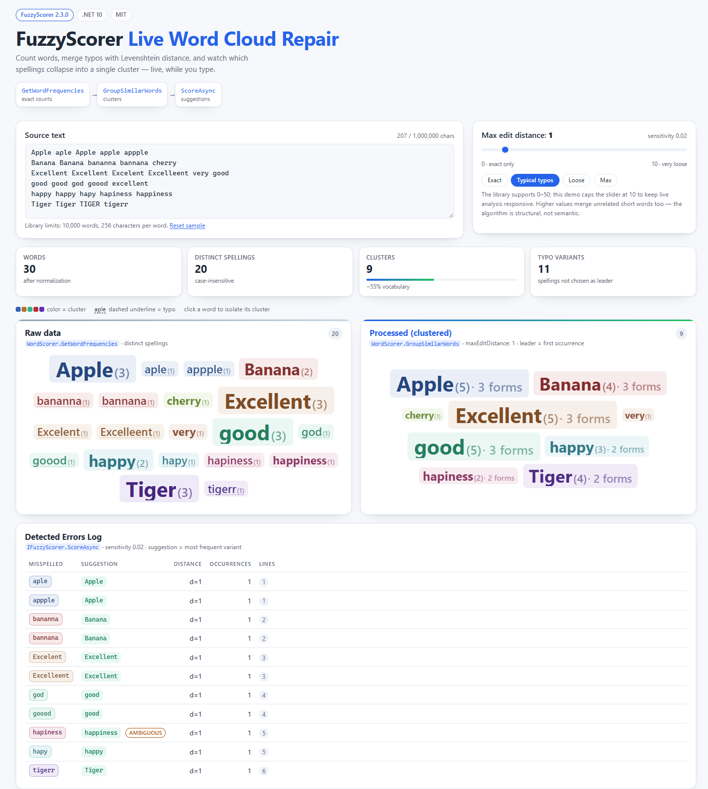

# FuzzyScorer.Demo

Blazor WebAssembly demo app showcasing the
[FuzzyScorer](https://www.nuget.org/packages/FuzzyScorer) NuGet package (v2.3.0) —
real-time word cloud clustering using Levenshtein distance typo correction.

Targets **.NET 10.0**.



## Run

```bash
dotnet run
```

Opens at `http://localhost:5231`.

## Demo behavior

- The edit-distance slider is capped at **10** (the library supports 0–50) to keep
  live analysis responsive.
- Recalculation is debounced by 300 ms and cancelled when a newer edit or slider
  change arrives.
- Input limits (enforced by FuzzyScorer): 1,000,000 characters, 10,000 words, and
  256 characters per word. The UI shows the character limit and reports oversized
  input instead of failing silently.
- `wwwroot/index.html` contains a meta Content-Security-Policy. Directives such as
  `frame-ancestors` must be configured as response headers by the hosting provider.
  The policy can interfere with browser hot reload during development; remove the
  meta tag temporarily if hot reload is needed.
