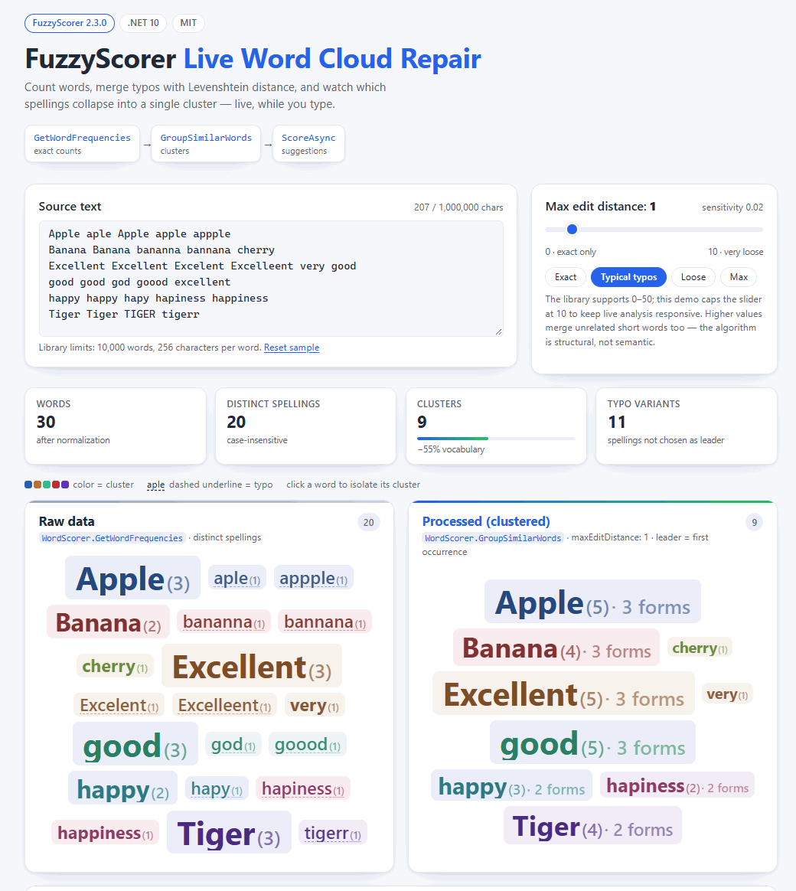

# FuzzyScorer.Demo

Blazor WebAssembly demo app showcasing the
[FuzzyScorer](https://www.nuget.org/packages/FuzzyScorer) NuGet package (v2.3.0) —
real-time word cloud clustering using Levenshtein distance typo correction.

Targets **.NET 10.0**.




*Live: switching the edit distance, isolating the Apple cluster, and comparing loose matching.*

## Run

```bash
dotnet run
```

Opens at `http://localhost:5231`.

## Reading the demo

- **Color = cluster.** Every spelling in the left cloud is tinted with the color of the
  cluster it ends up in on the right, and the same color appears in the error log.
  Hues are assigned by cluster size, so the largest clusters get the most distinct colors.
- **Dashed underline = typo.** A dashed underline marks spellings that the library treats
  as variants of the cluster leader. Hover a word to see the suggestion (`aple → Apple`)
  and the Levenshtein distance.
- **Click to isolate.** Click any word — or a misspelled word in the log — to dim all other
  clusters. `Show all clusters` clears the selection.
- **Slider and presets.** `Exact` (0), `Typical typos` (1), `Loose` (3), and `Max` (10) set
  the edit distance; the current `ScoreAsync` sensitivity is shown next to the label.
- **Summary tiles.** Words, distinct spellings, clusters, and typo variants update after
  each debounced recalculation; the bar shows how much the vocabulary shrank.
- **Error log.** Each row pairs the misspelled word with the suggestion returned by
  `ScoreAsync`, the edit distance, occurrences, and 1-based line numbers. An `ambiguous`
  badge means several variants shared the top frequency, so the suggestion is not certain.
- **Dark mode** follows the operating-system color scheme (CSS only, no toggle).

## Demo behavior

- The demo starts at edit distance **1**. Raising it can merge shorter, unrelated words
  too — the algorithm is structural, not semantic — which is useful to explore but not a
  good default. The sample text keeps the correct spelling most frequent so the
  suggestions read naturally.
- The edit-distance slider is capped at **10** (the library supports 0–50) to keep live
  analysis responsive.
- Recalculation is debounced by 300 ms and cancelled when a newer edit or slider change
  arrives.
- Input limits (enforced by FuzzyScorer): 1,000,000 characters, 10,000 words, and
  256 characters per word. The UI shows the character limit and reports oversized input
  instead of failing silently.
- `wwwroot/index.html` contains a meta Content-Security-Policy. Directives such as
  `frame-ancestors` must be configured as response headers by the hosting provider.
